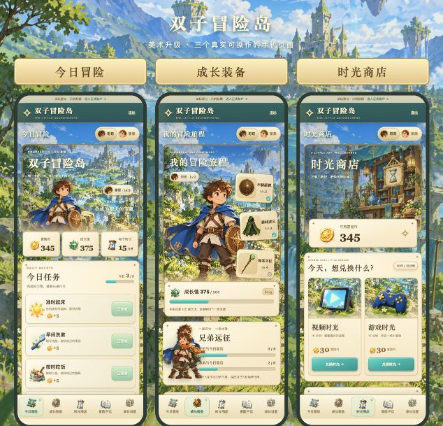

# 双子冒险岛 · Twin Adventure

一个手机优先的家庭习惯打卡网站，把每天的小小坚持变成一次冒险。家长负责记录和奖励，两个孩子拥有独立账户、金币、时长钱包与成长装备。

A mobile-first family habit tracker with parent-managed rewards, independent child accounts, screen-time wallets and collectible fantasy equipment.



## 功能

- **独立账户**：一个家长账户、两个孩子账户，孩子只能查看自己的账本与明细。
- **家长打卡**：任务完成后，由家长记录；支持有原因的当天更正。
- **可配置任务**：新增任务、修改完成标准和奖励，指定适用哪个孩子，暂停任务。
- **双账成长**：金币可以消费；累计成长值用于升级，兑换奖励不会降低成长值。
- **电子时长**：默认30金币换15分钟，视频／游戏分别记账，可配置日周额度。
- **计时扣减**：开始时预留时长，提前结束退回未使用的秒数，也可事后补记实际用时。
- **宝贝图鉴**：八级装备解锁、地图节点、装备详情、打卡与升级反馈。
- **兄弟远征**：分享今日完成进度摘要，详细记录保持独立。
- **历史与导出**：日期／类型筛选，CSV流水导出、完整JSON备份。
- **两种后端**：Node.js＋SQLite本机服务；腾讯云CloudBase云函数＋数据库。

## 本机启动

需要 **Node.js 24或更高版本**。本机服务使用Node内置SQLite，无需安装前端依赖。

```sh
git clone https://github.com/AIpanda1129-lab/twin-adventure.git
cd twin-adventure
npm start
```

打开 **http://127.0.0.1:4173/**，首次设置三个账户密码，每个8—128位。账号分别为`parent`、`older`、`younger`。

本机回环地址直接访问时可完成初始化。非本机或生产部署需要初始化口令；在首次启动时通过`SETUP_TOKEN`环境变量设置，或从服务端`data/setup-token.txt`读取。口令只在初始化时使用。生产环境需要HTTPS反向代理，并设置`NODE_ENV=production`。

真实记录保存在当前实例的`data/`目录，目录已加入忽略列表。请使用自己的密码与数据；仓库没有预置正式账号或家庭记录。

## 先体验美术与玩法

启动本机服务后打开：

- **http://127.0.0.1:4173/?demo**：示例任务、金币和装备，可随意体验，刷新重置。
- **http://127.0.0.1:4173/art-review.html**：三个390像素宽的真实手机页面对照。

只需静态预览时，也可以运行：

```sh
python3 -m http.server 8080 --directory public
```

然后访问`http://127.0.0.1:8080/?demo`。静态预览只有演示功能；正式账户和跨设备记录需要后端。

## 腾讯云部署

详细步骤见[部署说明](docs/DEPLOYMENT.md)。使用自己的CloudBase环境、网站地址及初始化口令，不依赖作者的个人云服务。

```sh
cp .env.example .env
# 编辑.env，填写自己的环境和网站/API地址
npm run cloud:prepare
npm ci --prefix cloud/twin-adventure-api
```

生成的云配置、初始化口令及口令哈希文件均被Git忽略。部署准备脚本会更新`public/config.js`供自己的静态站使用；提交前可恢复这个文件的同源默认配置。

## 测试

```sh
npm test
```

12项检查覆盖：独立账本、儿童权限、并发防重复、奖励快照、兑换扣款、计时到期、提前退款、额度、任务分配、更正审计、HTTP登录与重启持久化。HTTP检查使用独立临时目录，不接触真实家庭数据。

## 项目结构

```text
public/                    网页、演示模式和全部美术素材
public/assets/             角色、场景、装备与图标图集
domain.mjs                 任务、金币、时长与成长规则
server.mjs                 本机Node服务和SQLite持久化
cloud/twin-adventure-api/   CloudBase HTTP函数
scripts/prepare-cloud.mjs   生成自己的云端配置与初始化凭据
test/                      规则与HTTP集成测试
screenshots/               示例数据界面截图
docs/                      部署说明、素材来源和生成提示词
```

## 当前范围

系统提供计时、额度与记账，无法强制关闭其他游戏、视频App或锁机；关闭网页后不保证提醒音响起。装备以图鉴和解锁反馈展示，尚无角色换装动画或战斗。现金支付、实物库存、周赛奖励、节假日日历、历史补打卡、密码找回与自助恢复尚未实现。

当前版本针对单个家庭使用，固定包含两个孩子。云端在每日首次记账前保留快照并按30日槽轮换；本机版另有本地快照。请定期导出JSON并保存到独立位置。

## 美术与开源许可

角色、场景、装备、图标为项目制作的AI生成美术，纸张颗粒为代码绘制素材。来源及说明见[素材说明](docs/ASSETS.md)，生成提示词见[art-prompts.json](docs/art-prompts.json)。仓库不包含任何官方游戏角色、Logo、音乐或拆包素材。

源码及项目自有素材以[MIT许可证](LICENSE)发布。第三方依赖沿用各自许可证。欢迎通过Issue或Pull Request反馈问题、改进玩法。
